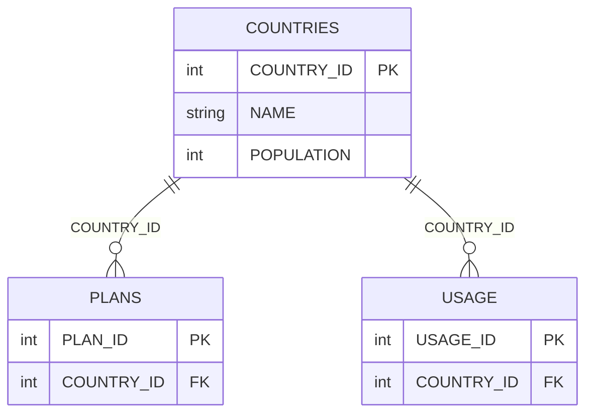
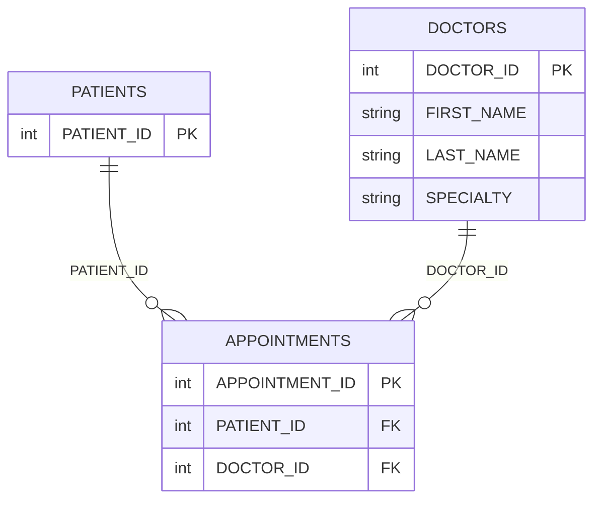
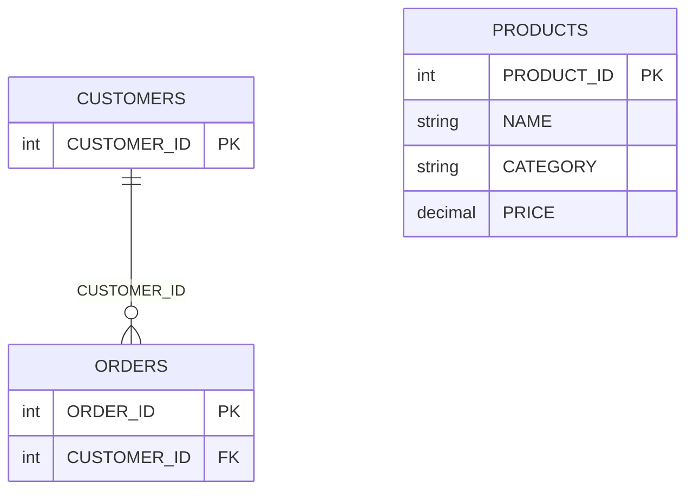

## **This agentic program takes a plain-English request, uses ChatGPT to decide the steps, and builds demo databases in Snowflake with related tables and sample data, such as these:**

- DEMO_OCT_31_CELL_PHONE_USAGE: COUNTRIES, PLANS and USAGE tables, linked by COUNTRY_ID.
- DEMO_OCT_31_HOSPITAL_SCHEDULING: PATIENTS, DOCTORS and APPOINTMENTS tables, linked by PATIENT_ID and DOCTOR_ID.
- DEMO_OCT_31_RETAIL_SALES: CUSTOMERS, ORDERS and PRODUCTS tables, with ORDERS linked to CUSTOMERS by CUSTOMER_ID.

